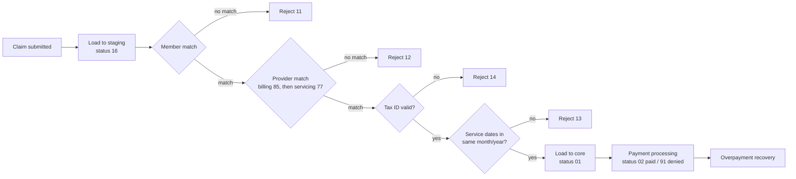

# Healthcare Claims Processing System (FACETS-Style) — SQL Server

A SQL Server project that simulates how a health insurance payer processes medical claims, from intake through validation, adjudication, and payment. It's modeled on the FACETS claims platform used by many U.S. health plans.

A submitted claim lands in a **staging** database. It's checked against member and provider master data, validated, promoted into the **core** claims database, then priced and paid. Every step is logged, and rejected claims are kept with a reason code.

**Tools:** SQL Server, T-SQL (stored procedures, transactions, TRY/CATCH, temp tables, table-valued parameters, sequences, cursors)

---

## Claim Lifecycle



## Claim Status Codes

| Code | Meaning |
|---|---|
| 16 | Submitted / passed preprocessing |
| 01 | Loaded to core |
| 02 | Paid |
| 11 | Member not found |
| 12 | Provider not found |
| 13 | Service date validation failed |
| 14 | Provider tax ID validation failed |
| 15 | Errored out |
| 91 | Fully disallowed |

---

## Database Design

The project uses three databases, each with a separate job:

| Database | Purpose | Key tables |
|---|---|---|
| **FACETS_STG** | Staging. Claims land here unverified. | `STG_CMC_CLCL` (claim header), `STG_CMC_CDML` (claim lines), `STG_CMC_CLPR` (submitted providers), `STG_CMC_MEME` (submitted member) |
| **FACETS** | Core. Validated claims plus member and provider master data. | `CMC_CLCL`, `CMC_CDML`, `CMC_MEME` (members), `CMC_PRPR` (providers), `CMC_ACPR` (payment reductions), `CMC_ACRH` (recovery history), `CMC_CLOV` |
| **FACETS_Custom** | Back office. Logging, work tables, sequence, and table types. All procedures run from here. | `CLM_JOB_STEP_LOG`, `CLM_JOB_ERR_LOG`, `CW_RJCT_CLCL` (rejected claims) |

---

## Stored Procedures

| # | Procedure | What it does |
|---|---|---|
| 04 | `USP_CLM_STEP_ERR_LOG` | Shared logger. Every procedure calls it after each step to record rows processed, status, and any error. |
| 05 | `USP_CLM_LOAD_STG_DATA` | Loads a submitted claim (header, service lines, providers, member) into staging and generates a unique claim ID from a sequence. |
| 06 | `USP_CLM_MBR_MTCH` | Matches submitted member info against the member master. Rejects unmatched claims with status 11. |
| 07 | `USP_CLM_PRPR_MTCH` | Matches the provider NPI against the provider master: billing provider (85) first, servicing provider (77) as a fallback. Rejects with status 12. |
| 08 | `USP_CLM_TAXID_VAL` | Confirms the submitted tax ID matches the tax ID on file for the matched provider. Rejects with status 14. |
| 09 | `USP_CLM_SVCDT_VAL` | Confirms all service lines on a claim fall in the same calendar month and year. Rejects with status 13. |
| 10 | `USP_CLM_STG_TO_CORE` | Moves accepted claims from staging into core (status 01), saves rejected claims to the reject table, and cleans up staging. |
| 11 | `USP_CLM_PYMT_PRCS` | Applies per-line deduction percentages and an explanation code, calculates the total payable, and creates payment reduction records. Sets status 02 (paid) or 91 (fully disallowed). |
| 12 | `USP_CLM_PYMT_RECOV` | Records a provider paying back an overpayment (full or partial), updates the outstanding balance, and logs each recovery event. |

**Patterns used throughout:**

- Each procedure wraps its work in a transaction with TRY/CATCH, so a failure rolls back cleanly and is written to the error log.
- Each step writes an audit row, including rows processed.
- Validation procedures only evaluate claims still in status 16, so already-rejected claims aren't processed twice.
- NPI and name values are trimmed before matching to handle messy submitted data.

---

## How to Run

Run the scripts in numbered order in SQL Server Management Studio (SSMS):

1. `01`–`03` create the three databases, tables, sequence, and table types.
2. `04`–`12` create the stored procedures in `FACETS_Custom`.
3. Add sample members and providers to `FACETS.dbo.CMC_MEME` and `FACETS.dbo.CMC_PRPR`.
4. Submit a test claim. A commented example call is at the top of `05_USP_CLM_LOAD_STG_DATA.sql`.
5. Run the processing pipeline:

```sql
USE FACETS_Custom;
EXEC dbo.USP_CLM_MBR_MTCH;
EXEC dbo.USP_CLM_PRPR_MTCH;
EXEC dbo.USP_CLM_TAXID_VAL;
EXEC dbo.USP_CLM_SVCDT_VAL;
EXEC dbo.USP_CLM_STG_TO_CORE;
```

6. Review results in `CLM_JOB_STEP_LOG`, `CW_RJCT_CLCL`, and `FACETS.dbo.CMC_CLCL`.

> All data used in this project is fictional. No real patient information is included.

---

**Author:** Puspa Bhatt · [LinkedIn](https://linkedin.com/in/puspabhatt)
